# Econ 5166 Project Proposal

- Group: DSSI2026 第 7 組
- Date created: 20261008
- Template: [econ-5516-proposal-template.md](../templates/report/econ-5516-proposal-template.md)

第 7 組

成員：

r14546021 黃敬翔

B12303146 蔡昇諺

B11610053 黃欣予

B12303006 林丞翊

## 1. 專案敘述：研究問題、動機與研究方法（組員共同討論，PM 彙整）

### 研究問題

既有研究顯示 F1 名次約九成由車隊決定，但同樣的車交給不同車手，結果仍有差異，而這些差異是否在開賽前就能辨識、是否有預測價值，目前沒有答案。本研究以 2011–2024 年資料，在正賽開跑前預測車手是否進入前三名，回答兩個問題：

1. **賽前資訊的上限在哪裡**：只用開賽前已知的資訊（起跑位置、排位賽速度差距、車手與車隊近期表現、車隊近期策略傾向、賽道特性、天氣），能把前三名預測到多準？
2. **車手本身還剩多少**：在控制起跑位置與車隊實力後，由前一季單圈與進站行為分出的駕駛風格群，是否仍能提升預測表現？

無論答案是肯定或否定，都能回答「賽前能知道的車手特質，對 F1 結果有多少解釋力」。本研究為預測問題，不作因果解釋。

### 研究動機

本研究的動機可以濃縮成四句話：資料顯示 F1 的名次約九成由賽車決定；但同一台車交給不同車手，結果仍會不同；這個「人」的部分被轉播與評論形容了幾十年，卻從未被科學形塑出來，也沒人拿去預測；所以我們來測。以下依序展開。

F1 有一個經常被討論的問題：「究竟是車快，還是人快？」資料看起來偏向車：2023 年 Red Bull 在 22 場大獎賽贏了 21 場；2024 年摩納哥站前十名的完賽順序與起跑順序完全一致，比賽在週六排位賽後就幾乎定了。既有研究也支持這個印象，車隊大約能解釋九成的名次變異（van Kesteren 與 Bergkamp，2023）。如果真是如此，預測每場前三名不會太難。但 F1 也不乏令人意外的比賽：2020 年沙基爾站，Mercedes 的替補車手首次駕駛便長時間領先卻錯失勝利，最後奪冠的是第一圈事故後跌到最後一名、開著中游賽車一路追回的 Sergio Pérez。同一個運動，有時賽前資訊幾乎決定結果，有時卻完全失效。

名次約九成由賽車決定，那剩下的一成，有多少是車手本身？轉播與評論常用「激進」、「穩定」、「擅長輪胎管理」形容車手，但這些標籤從未被量化，也沒人檢驗過它們對結果有沒有預測力。既有文獻分成三條線各走各的：一條把車手能力從賽車中分離出來、事後評價誰最強（Eichenberger 與 Stadelmann，2009；Phillips，2014；Bell 等人，2016；van Kesteren 與 Bergkamp，2023），但不描述車手怎麼開；一條用機器學習直接預測名次（Krzysztoń 與 Smołka，2026），但把賽中資料也放進特徵；一條從圈速與遙測分出駕駛風格群（Secco 與 Taylor，2026），但停在描述，沒有拿去預測。三條線沒有人接起來：**在已知起跑位置與車隊實力、且只用賽前可知資訊的情況下，由歷史資料分出的駕駛風格是否仍能提供額外的預測資訊？**

因此本專案結合**分群（Clustering）與預測（Prediction）**：先用歷史賽事資料建立可量化的駕駛特徵並分出風格群，再以起跑位置與車隊實力建立基準模型，加入風格群後比較對頒獎台預測能力的提升。我們問的不是哪位車手最強，而是**在控制主要賽前資訊後，駕駛風格是否具有額外的預測價值（Incremental Predictive Value）**。即使提升有限，也能回答賽前可知的車手特質究竟能解釋多少 F1 的比賽結果。

### 資料來源

1. **Formula 1 World Championship (1950 - 2024)**（Kaggle，源自 Ergast）：已取得 14 個 CSV，含賽程、賽道、車隊、車手、排位賽、正賽與衝刺賽結果、單圈時間、進站紀錄、完賽狀態。限制：進站紀錄自 2011 年起才有，決定了樣本起點；單圈資料沒有安全車、虛擬安全車與紅旗的標記，只能以圈速門檻近似排除；沒有輪胎配方資料。
2. **FastF1**（Python 套件）：輪胎配方與賽道狀態，僅涵蓋 2018 年以後，尚未下載。列為備用來源，主分析不使用。
3. **Open-Meteo** Historical Weather API：以賽道經緯度與開賽時間查詢比賽日的逐時氣溫與降雨，尚未串接。限制：取得的是實際天氣而非賽前預報，在模型中作為預報的代理變數。

### 研究方法

研究分為兩個階段：

**第一階段：非監督式分群（駕駛風格）**

分析單位與樣本：以「車手 × 賽季」為單位（每位車手每季一筆），使用 2011–2023 年。一季正賽出賽少於 5 場者不納入分群（2011–2024 年共 323 個車手 × 賽季，排除 20 個，占 6.2%）。季中換隊者（7 個車手 × 賽季）仍為一筆，每場以當場隊友計算。

特徵：為降低車隊性能與車隊策略的干擾，每場兩位隊友的特徵值拆成兩部分：「車手部分」為該車手減去隊友，用於分群；「車隊部分」為兩位隊友的平均，作為第二階段的控制變數。所有特徵先逐場計算再取整季平均，沒有隊友的場次不計。計算圈速與輪胎特徵時，每場先排除第 1 圈、進站圈與下一圈、慢於該車手該場中位數 10% 以上的圈（近似排除安全車與紅旗圈）；排除後有效圈數少於 10 圈的場次，不計入這兩類特徵。

車手部分（用於分群）：

| 組別 | 變數 | 每場算法 $f_m(i,r)$ | 整季彙整 |
| --- | --- | --- | --- |
| 圈速穩定度 | `stab_tm` | 單圈時間標準差 ÷ 該車手該場中位數圈速，減隊友 | 平均 |
| 輪胎衰退 | `deg_tm` | 以進站圈切 stint，每段（至少 5 圈）圈速對圈數做簡單迴歸取斜率，該場各段平均，減隊友 | 平均 |
| 相對隊友速度 | `pace_tm` | （該車手中位數圈速 − 隊友中位數圈速）÷ 隊友中位數圈速 × 100 | 平均 |
| 攻擊性 | `gain_tm` | `grid` − `positionOrder`，減隊友；`grid` 依第 3 節規則處理 | 平均 |
| 攻擊性 | `dnf_nonmech` | 非機械退賽記 1（分類見第 3 節共用編碼規則；不減隊友） | 整季比率 |
| 進站傾向 | `stops_tm` | 進站次數，減隊友 | 平均 |
| 進站傾向 | `first_stop_tm` | 第一次進站圈 ÷ 該場總圈數，減隊友 | 平均 |

以 $i$ 表示車手、$s$ 表示賽季、$r$ 表示場次、$j(r)$ 表示車手 $i$ 在第 $r$ 場的隊友、$\mathcal{R}_{is}$ 表示車手 $i$ 在賽季 $s$ 的有效場次。除 `dnf_nonmech` 外，車手部分特徵為

$$
x^{(m)}_{is} = \frac{1}{|\mathcal{R}_{is}|} \sum_{r \in \mathcal{R}_{is}} \Big[ f_m(i,r) - f_m\big(j(r),r\big) \Big]
$$

`dnf_nonmech` 為

$$
x^{(\text{dnf})}_{is} = \frac{1}{|\mathcal{R}_{is}|} \sum_{r \in \mathcal{R}_{is}} \mathbf{1}\big[\, i \text{ 於第 } r \text{ 場非機械退賽} \,\big]
$$

車隊部分（車隊風格）：只計算與車隊策略和賽車特性有關的三項，每場以兩位隊友的平均減去該場全場中位數表示，分別為進站次數、第一次進站圈 ÷ 總圈數、stint 斜率。車隊部分不分群，在第二階段以該車隊前 5 場的平均（`team_stops_l5`、`team_first_stop_l5`、`team_deg_l5`）作為控制變數。相對隊友速度與名次推進的車隊部分反映的是賽車性能，已由 `con_points_l5` 與 `quali_gap_pct` 控制，不另外計算。以 $c$ 表示車隊，車隊 $c$ 在第 $r$ 場的車隊部分，以及第二階段使用的前 5 場平均為

$$
T^{(m)}_{cr} = \tfrac{1}{2}\Big[ f_m(i,r) + f_m\big(j(r),r\big) \Big] - \operatorname{med}_{d \in r} f_m(d,r),
\qquad
\texttt{team\_}m\texttt{\_l5}_{cr} = \frac{1}{5} \sum_{q=1}^{5} T^{(m)}_{c,\,r-q}
$$

其中 $r-q$ 為車隊 $c$ 在第 $r$ 場之前的第 $q$ 場。

模型：

1. 標準化：七個車手部分特徵以 2011–2021 年資料的平均與標準差做 z-score，$z^{(m)}_{is} = \big(x^{(m)}_{is} - \bar{x}^{(m)}\big) / \hat{\sigma}^{(m)}$，得到七維向量 $\mathbf{z}_{is}$。
2. 分群：以 2011–2021 年的車手 × 賽季估計 K-means，即在給定群數 $K$ 下，找出群 $C_1,\dots,C_K$ 與群中心 $\boldsymbol{\mu}_1,\dots,\boldsymbol{\mu}_K$，使群內平方和最小：

   $$
   \min_{C_1,\dots,C_K,\ \boldsymbol{\mu}_1,\dots,\boldsymbol{\mu}_K} \ \sum_{k=1}^{K} \sum_{(i,s) \in C_k} \big\lVert \mathbf{z}_{is} - \boldsymbol{\mu}_k \big\rVert^2
   $$

   $K = 2$–$6$，每個 $K$ 取 50 組隨機起始點中的最佳解。
3. 選定群數：以輪廓係數為主、手肘法為輔。對每一筆觀察值，$a_{is}$ 為其到同群其他點的平均距離，$b_{is}$ 為其到最近另一群各點的平均距離，

   $$
   \text{sil}_{is} = \frac{b_{is} - a_{is}}{\max(a_{is},\, b_{is})},
   \qquad
   K^{*} = \arg\max_{K \in \{2,\dots,6\}} \ \overline{\text{sil}}(K)
   $$

   並以手肘法（群內平方和隨 $K$ 下降的轉折點）輔助確認。
4. 穩定性檢驗：以 Ward 階層式分群切成相同群數，計算與 K-means 結果的 Adjusted Rand Index（ARI）。
5. 標籤指派：2022、2023 年的車手 × 賽季不重新分群，以 2011–2021 年的標準化參數轉換後，指派到最近的群中心。這樣測試期（2023–2024）用到的標籤不會回頭影響分群。所有年份的標籤皆為

   $$
   \texttt{style\_cluster}_{is} = \arg\min_{k} \big\lVert \mathbf{z}_{is} - \hat{\boldsymbol{\mu}}_k \big\rVert
   $$

6. 命名：依各群中心的特徵值命名（例如穩定型、激進型）。

輸出：一筆為一個車手 × 賽季，欄位含 `driverId`、`year`、出賽場數、七個車手部分特徵、`style_cluster`。跑完資料後才會確定的是 $K^{*}$、群中心 $\hat{\boldsymbol{\mu}}_k$ 與各筆的群標籤。

避免資料洩漏：分群標籤放入第二階段時，預測第 t 季比賽只使用第 t−1 季的分群標籤（`style_cluster_prev`），確保模型只用到開賽前已知的資訊。第 t 季新進的車手沒有前一季標籤，另設「無前季資料」類別，不直接刪除；前一季未達 5 場門檻者亦同。

**第二階段：監督式分類（前三名預測）**

預測時點設在排位賽結束後、正賽開跑前。以「該車手於該場正賽是否進入前三名」作為二元目標變數，特徵限於此時已知的資訊：起跑位置與排位賽速度差距、車手與車隊近期表現、車隊策略傾向（進站次數、進站時機與輪胎衰退的車隊部分）、平均進站時間與近期圈速表現、賽道特性、比賽日天氣，以及前一季的駕駛風格分群標籤。為確保所有特徵在開賽前即可觀察，進站與單圈相關特徵皆以該車手或該車隊前 5 場比賽的平均值計算。比較下列模型：

- 基準模型：Logistic regression。
- 機器學習模型：Random forest、Gradient boosting（如 XGBoost）。

以 $p_{ir}$ 表示車手 $i$ 在第 $r$ 場進入前三名的機率。Logistic regression 的設定為

$$
\log\frac{p_{ir}}{1-p_{ir}} = \beta_0 + \boldsymbol{\beta}^{\top}\mathbf{X}_{ir} + \boldsymbol{\delta}^{\top}\mathbf{T}_{c(i),r} + \sum_{k \neq \text{base}} \gamma_k \, \mathbf{1}\big[\texttt{style\_cluster\_prev}_{ir} = k\big]
$$

其中 $\mathbf{X}_{ir}$ 為第 3 節中除車隊策略傾向與分群標籤以外的特徵（`grid`、`pitlane_start`、`quali_gap_pct`、`quali_missing`、`avg_pit_duration`、`lap_time_mean`、`lap_time_sd`、`drv_avg_finish_l5`、`finish_l5_missing`、`con_points_l5`、`street_circuit`、`air_temp_mean`、`precip_mm`），$\mathbf{T}_{c(i),r}$ 為車手 $i$ 所屬車隊的車隊策略傾向（`team_stops_l5`、`team_first_stop_l5`、`team_deg_l5`、`team_l5_missing`）。分群標籤以樣本數最多的群為基準類別，「無前季資料」另設一個虛擬變數。Random forest 與 XGBoost 使用相同的特徵，不設函數形式。

為回答第二個研究問題，每個模型各估計兩個版本：(a) 不含分群結果、(b) 加入駕駛風格分群標籤；兩版都包含車隊策略傾向，因此 (b) 相對 (a) 的提升，代表控制車隊策略之後，車手風格的額外預測力。以 logistic regression 而言，(a) 版即限制所有 $\gamma_k = 0$。並以依賽季切分的訓練／測試集（2012–2022 年訓練、2023–2024 年測試）比較兩者的準確率、F1 score 與 AUC，檢驗分群是否提升預測表現；兩版 AUC 的差距以 bootstrap 重抽樣估計信賴區間。由於前三名僅占約 15%，以 F1 score 與 AUC 為主要評估指標。

## 2. 已有之 raw data

**circuits(賽道基本資料)**

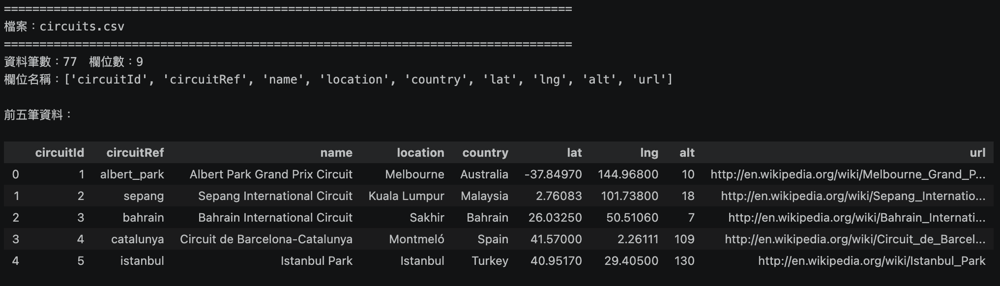

**constructors(車隊基本資料)**

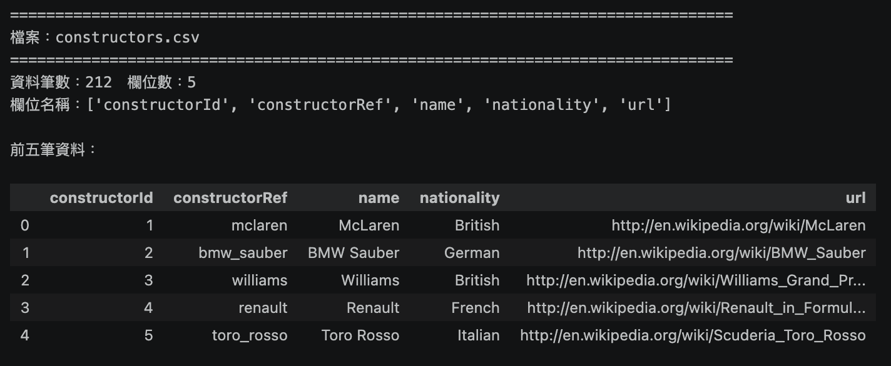

**constructor_results(車隊單場得分)**

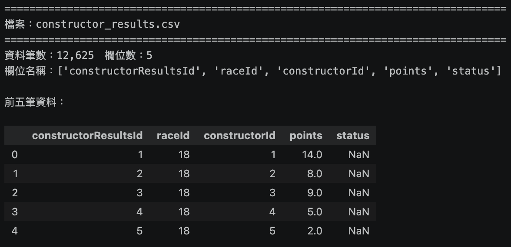

**constructor_standings(車隊積分榜)**

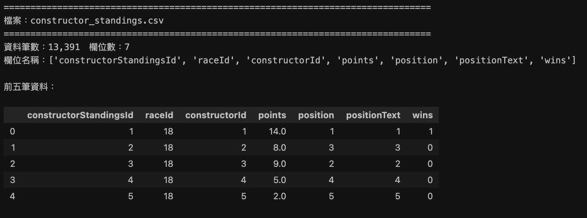

**drivers(車手基本資料)**

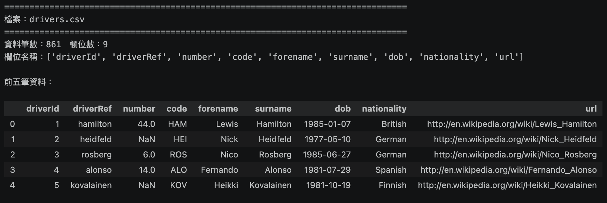

**driver_standings(車手積分榜)**

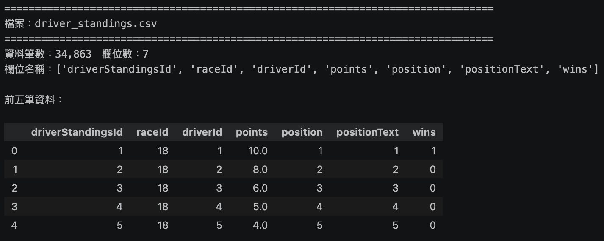

**lap_times(單圈時間)**

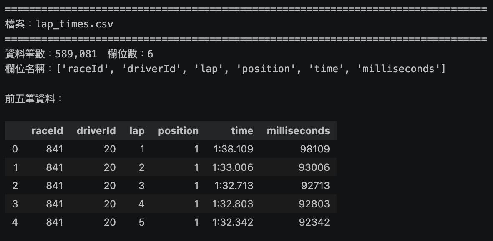

**pit_stops(進站紀錄)**

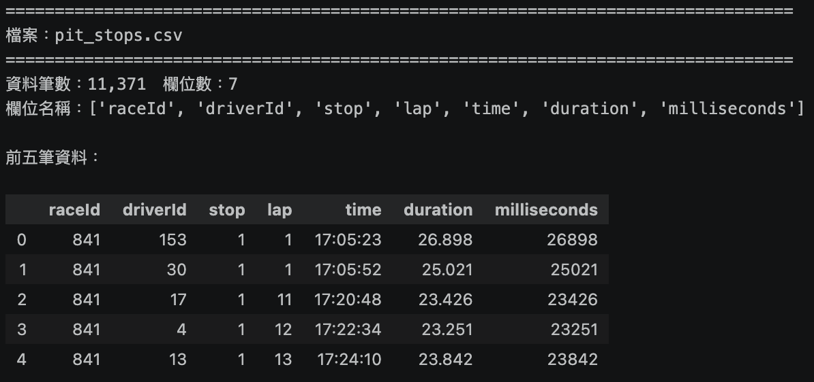

**qualifying(排位賽成績)**

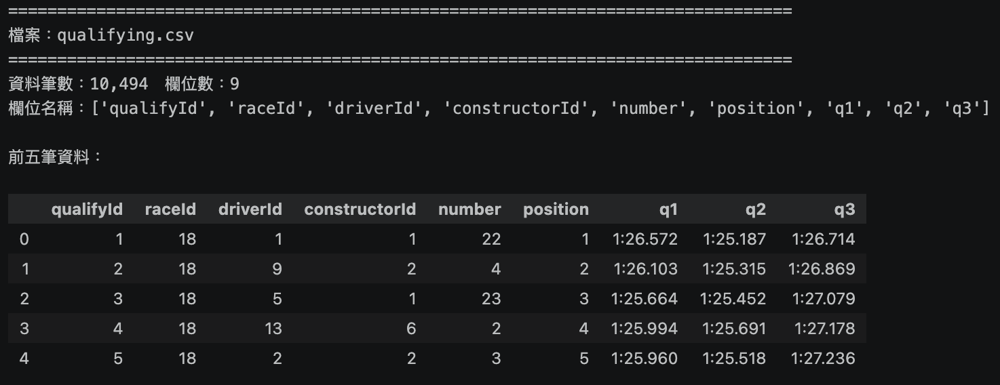

**results(每場比賽的車手成績)**

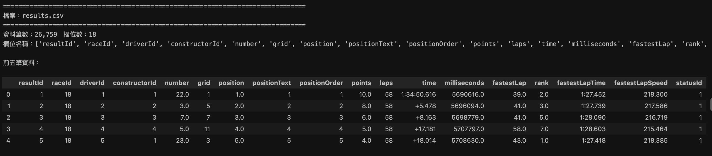

**sprint_results(衝刺賽成績)**

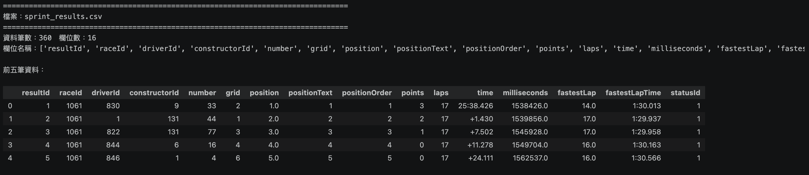

**status(完賽狀態代碼)**

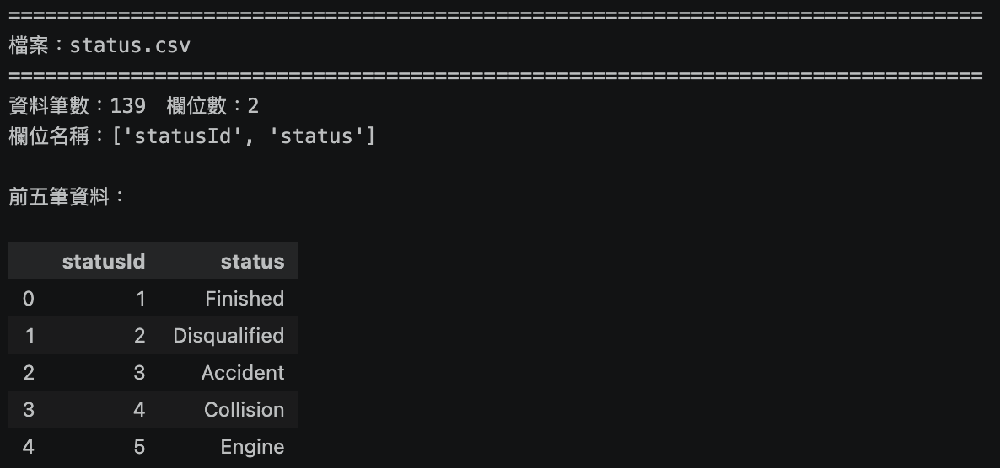

## 3. 主要分析用資料需求（組員共同討論，DA 負責撰寫，DE 確認可執行）
(DA DE 各輸出一版 10/10)

樣本時間：使用 2011–2024 年。進站資料（`pit_stops.csv`）自 2011 年起才有，單圈時間（`lap_times.csv`）自 1996 年起即完整，因此樣本起點由進站資料決定（已以 `data/raw/` 核對確認）。由於第一階段的分群標籤採用前一季結果，2011 年資料主要用於建立第一季的分群與歷史表現特徵，第二階段的模型樣本實際上從 2012 年開始。

範圍：各賽季所有大獎賽的全部參賽車手（不含衝刺賽），一筆觀察值為「一位車手在一場比賽」。2012–2024 年共 267 場、5,524 筆觀察值，其中前三名 801 筆（14.5%）。

| raceId | year | circuitId | driverId | constructorId | grid | pitlane_start | quali_gap_pct | quali_missing | team_stops_l5 | team_first_stop_l5 | team_deg_l5 | team_l5_missing | avg_pit_duration | lap_time_mean | lap_time_sd | drv_avg_finish_l5 | finish_l5_missing | con_points_l5 | street_circuit | air_temp_mean | precip_mm | style_cluster_prev | podium |
| --- | --- | --- | --- | --- | --- | --- | --- | --- | --- | --- | --- | --- | --- | --- | --- | --- | --- | --- | --- | --- | --- | --- | --- |
| 1101 | 2023 | 3 | 830 | 9 | 1 | 0 | 0.00 | 0 | -0.2 | 0.03 | -0.012 | 0 | 23.4 | -0.42 | 0.71 | 1.8 | 0 | 38.2 | 0 | 27.5 | 0.0 | 2 | 1 |
| 1101 | 2023 | 3 | 1 | 131 | 4 | 0 | 0.41 | 0 | 0.4 | -0.05 | 0.008 | 0 | 24.1 | 0.15 | 0.88 | 5.6 | 0 | 21.0 | 0 | 27.5 | 0.0 | 1 | 0 |
| … | … | … | … | … | … | … | … | … | … | … | … | … | … | … | … | … | … | … | … | … | … | … | … |

（表中數值皆為假想示意，非實際資料。）

欄位說明：

- `grid`：排位賽起跑位置。`grid = 0` 表示維修區起跑（82 筆），編為該場起跑人數 + 1（2011–2016 年每場有 22–24 台車，不寫死為固定值），並另設 `pitlane_start` = 1。
- `quali_gap_pct`：該車手排位賽最後一段有成績的最佳圈速（依 Q3、Q2、Q1 順序取有值者；「1:23.529」字串轉為秒數，`\N` 視為無成績）與桿位圈速的差距（%），補充起跑位置無法反映的速度差距。完全沒有排位成績者（Q1 無成績 58 筆、`results` 有但 `qualifying` 沒有 20 筆，共 78 筆）以該場最大差距代入，並另設 `quali_missing` = 1。
- `team_stops_l5`、`team_first_stop_l5`、`team_deg_l5`：車隊策略傾向（第一階段的車隊部分），以該車隊前 5 場比賽計算。每場取兩位隊友的平均進站次數、第一次進站圈 ÷ 總圈數、stint 斜率（算法同第一階段），減去該場全場中位數，再取前 5 場平均；只有一位隊友有資料時以該位代入。不足 5 場者有幾場算幾場；新車隊沒有前場紀錄時代入 0（即與全場中位數相同），並另設 `team_l5_missing` = 1。2021 比利時站無人進站，該場進站次數記 0、第一次進站時機記缺值。
- `avg_pit_duration`：平均進站時間（維修組換胎速度），以該車手前 5 場比賽的平均值計算。進站時間以 `milliseconds` 計算（`duration` 有 517 筆為「分:秒」格式，不使用）；單次超過 60 秒視為紅旗等待，計算平均時排除。2021 比利時站無人進站，該場進站時間記缺值。
- `lap_time_mean`、`lap_time_sd`：近期圈速表現，以該車手前 5 場比賽計算。每場先排除第 1 圈、進站圈與下一圈（依 `pit_stops.csv` 的 `lap`）、慢於該車手該場中位數 10% 以上的圈（近似排除安全車與紅旗圈）；再計算 `lap_time_mean` 為該車手平均圈速相對全場中位數圈速的差距（%），`lap_time_sd` 為單圈時間標準差除以該車手該場中位數圈速；最後取前 5 場平均。原始秒數跨賽道不可比，因此一律以相對值表示。駕駛風格由 `style_cluster_prev` 代表，這兩欄只反映近期速度與穩定度。
- `drv_avg_finish_l5`：該車手前 5 場正賽的平均完賽順位，使用 `positionOrder`（退賽者 848 筆的 `position` 為 `\N`，但 `positionOrder` 仍有排序）。不滿 5 場者有幾場算幾場；沒有任何前場紀錄者以該季所有車手完賽順位（`positionOrder`）的中位數代入，並另設 `finish_l5_missing` = 1。
- `con_points_l5`：該車隊前 5 場正賽的平均積分（車隊歷史表現，控制賽車性能）。
- `street_circuit`：賽道特性，街道賽為 1、常設賽道為 0（人工標記，規則待定）。
- `air_temp_mean`、`precip_mm`：賽道所在地於開賽時間（UTC）前後兩小時的逐時資料，取氣溫平均（°C）與降雨加總（mm），對應研究問題中的氣候狀況。此為實際觀測值而非賽前預報；尚未取得。
- `style_cluster_prev`：第一階段分群得到的前一季（第 t−1 季）駕駛風格群標籤。第 t 季新進、沒有前一季標籤的車手（以及前一季未達分群最少場數門檻者，門檻待第一階段定案）歸入「無前季資料」類別，不刪除。
- `podium`：目標變數，`positionOrder` ≤ 3 為 1，否則為 0。

共用編碼規則（第一階段特徵與第 4 節假說二使用）：

- 隊友：同 `raceId`、同 `constructorId` 的另一位車手。僅 2 個場次的車隊不是剛好 2 人，記缺值。
- 退賽分類（依 `status.csv`）：非機械 = Collision、Accident、Collision damage、Spun off；機械 = Engine、Gearbox、Power Unit、Hydraulics、Brakes、Suspension、Electrical 等，「Retired」（59 筆）歸機械並標記；不算退賽 = Finished、+N Laps；Disqualified、Withdrew 排除。
- 勝過隊友：同場完賽順位（`positionOrder`）在隊友之前；兩人皆退賽的場次不計。

欄位來源與合併方式：

| 欄位 | 來源 |
| --- | --- |
| `raceId`、`year`、`circuitId`、`driverId`、`constructorId`、`grid`、`pitlane_start`、`podium` | Kaggle `results.csv`、`races.csv`；`podium` 由 `positionOrder` ≤ 3 編碼 |
| `quali_gap_pct`、`quali_missing` | Kaggle `qualifying.csv`（Q3／Q2／Q1 取最後一段有成績者），並以 `results.csv` 找出無排位紀錄者 |
| `team_stops_l5`、`team_first_stop_l5`、`team_deg_l5`、`team_l5_missing` | Kaggle `pit_stops.csv`、`lap_times.csv`、`results.csv`（以 `constructorId` 找同隊兩位車手），僅以該場之前的比賽計算 |
| `avg_pit_duration` | Kaggle `pit_stops.csv`（以 `milliseconds` 計算） |
| `lap_time_mean`、`lap_time_sd` | Kaggle `lap_times.csv`，以 `pit_stops.csv` 的 `lap` 排除進站圈 |
| `drv_avg_finish_l5`、`finish_l5_missing`、`con_points_l5` | Kaggle `results.csv`、`constructor_results.csv`，僅以該場之前的比賽計算 |
| `street_circuit` | Kaggle `circuits.csv` ＋人工標記 |
| `air_temp_mean`、`precip_mm` | Open-Meteo 歷史天氣 API，以 `circuits.csv` 的經緯度（lat／lng）與 `races.csv` 的 `date` ＋ `time`（UTC）查詢 |
| `style_cluster_prev` | 第一階段輸出，以 `driverId` ＋ `year − 1` 合併 |
| 第一階段特徵（車手 × 賽季） | Kaggle `lap_times.csv`、`pit_stops.csv`、`results.csv`（同場同隊另一位為隊友）、`status.csv`（退賽分類見共用編碼規則） |

待 DE 確認：

- Open-Meteo：尚未串接。以 `circuits.csv` 的 lat／lng 與 `races.csv` 的 `date` ＋ `time`（UTC，全部有值）查詢逐時資料，指定 `timezone=UTC`。
- FastF1：暫不下載，是否完全放棄待全組決定。
- `lap_time_mean`、`lap_time_sd`：計算方式已改為相對值，欄名暫不更動；是否改名（例如 `lap_gap_pct_l5`、`lap_cv_l5`）請 DE 決定。

## 4. 假說與預期主要結果（組員共同討論，DA 負責撰寫）

**假說一**：排位賽起跑位置是重要的預測因子，起跑位置越前面，進入前三名的機率越高；車隊過去幾場的進站策略傾向有額外但有限的預測貢獻。

**假說二**：車手的駕駛風格並非隨機，可透過單圈時間分布與進站行為分為數個具可解釋性的群（例如「穩定型」、「激進型」），且在同一車隊內比較時，不同風格群勝過隊友的比率在不同賽道類型（街道賽與常設賽道）有系統性差異。

**假說三**：將前一季的駕駛風格分群標籤（`style_cluster_prev`）加入預測模型，可提升前三名預測的表現（F1 score 與 AUC）。

### 預期主要結果

以下圖表與數值皆為**假想示意**，用來說明預期的結果型態。實際結果由 DE 在模型完成後填入對應的表格。

**對應假說一：起跑位置與車隊進站策略的預測力**

- Logistic regression 中，`grid` 的係數預期為負，也就是起跑位置越後面，進入前三名的機率越低。
- Random forest 的特徵重要性排序中，預期 `grid` 與 `quali_gap_pct` 排在最前面，其次是反映賽車性能的 `con_points_l5`。
- `team_stops_l5`、`team_first_stop_l5` 與 `avg_pit_duration`（該車隊或該車手前 5 場的平均）的重要性預期大於 0，但明顯低於起跑位置。這表示車隊過去的進站策略有額外但有限的預測力，但不是主要因素。

| 排名 | 特徵（假想） | 重要性（假想） |
| --- | --- | --- |
| 1 | `grid` | 0.32 |
| 2 | `quali_gap_pct` | 0.18 |
| 3 | `con_points_l5` | 0.14 |
| … | … | … |
| — | `team_stops_l5` | 0.04 |

**對應假說二：駕駛風格分群**

- 預期 K-means 依輪廓係數會選出 3–4 群，並能依特徵平均值命名，例如「穩定型」（圈速標準差小、輪胎衰退小）、「激進型」（名次推進多、退賽率高）、「策略型」（進站次數與時機偏離隊友）。
- 直接比較各風格群的前三名比率，結果會被車隊實力主導：強隊車手集中在哪一群，那一群的比率就高。因此改用同場同隊比較，計算各群車手完賽順位（`positionOrder`）勝過隊友的比率，兩人皆退賽的場次不計。Bell 等人（2016）發現車隊效果在雨天與街道賽減弱，因此預期車手之間的差異在街道賽較明顯。例如穩定型在不易超車的街道賽勝過隊友的比率較高，激進型則在常設賽道較高。

| 風格群（假想） | 街道賽勝過隊友比率 | 常設賽道勝過隊友比率 |
| --- | --- | --- |
| 穩定型 | 58% | 47% |
| 激進型 | 44% | 55% |
| 策略型 | 50% | 50% |

- 另外以「風格群 × 車隊」交叉表檢查分群是否只反映車隊。如果同一車隊的兩位車手常被分到不同群，表示分群確實捕捉到車手本身的差異。

**對應假說三：加入分群標籤是否提升預測表現**

- 預期 (b) 版（加入 `style_cluster_prev`）的測試集 AUC 與 F1 會略高於 (a) 版（不含分群），但差距不大；兩版 AUC 的差距以 bootstrap 信賴區間判斷。
- 如果兩版差距接近 0（信賴區間包含 0），代表駕駛風格的資訊可能已經被起跑位置與車手歷史表現涵蓋，假說三不成立。這仍是有意義的結果。

結果表（DE 將對應模型結果寫在這）：

| 模型 | 版本 | Accuracy | F1 | AUC |
| --- | --- | --- | --- | --- |
| Logistic regression | (a) 不含分群 | | | |
| Logistic regression | (b) 含分群 | | | |
| Random forest | (a) 不含分群 | | | |
| Random forest | (b) 含分群 | | | |
| XGBoost | (a) 不含分群 | | | |
| XGBoost | (b) 含分群 | | | |

## 5. 預期限制（組員共同討論，DA 負責撰寫）：

1. **資料範圍受進站紀錄限制**：Kaggle 的進站資料自 2011 年起才有，樣本起點因此定在 2011 年，第二階段模型實際從 2012 年開始，共約 13 季、5,500 筆。FastF1 的輪胎配方與賽道狀態只涵蓋 2018 年以後，無法用於全樣本，本研究不納入主分析，輪胎策略只能以進站次數與進站時間代理。
2. **安全車圈只能近似排除**：Kaggle 單圈資料沒有安全車、虛擬安全車與紅旗的標記，第一階段以「慢於該車手該場中位數 10% 以上」的門檻排除，可能漏抓或誤抓，影響圈速穩定度與輪胎衰退特徵的精確度。將以 2018 年以後的 FastF1 賽道狀態資料檢驗此規則的誤差。
3. **天氣為事後實際值且尚未取得**：Open-Meteo 提供的是比賽日實際天氣，不是賽前預報，模型中的天氣變數高估了真實預測情境可取得的資訊。雨戰一年僅兩三場，相關估計的變異大。天氣資料目前尚未串接，若無法取得，第二階段將先以不含天氣的版本進行。
4. **類別不平衡**：每場約 20 位車手中只有 3 位進入前三名，正例約 15%。整體準確率會被多數類別主導，因此以 F1 score 與 AUC 為主要指標，必要時對正例重新加權。
5. **賽車性能主導名次**：既有研究估計車隊可解釋約九成的名次變異，駕駛風格分群可能部分反映車隊而非車手本身。本研究以相對隊友特徵、車隊近期積分與「風格群 × 車隊」交叉表處理，但無法完全排除；季中換隊或隊友頻繁更換的車手，相對特徵的噪音較大。
6. **分群樣本小且標籤主觀**：車手-賽季 2011–2024 年共 323 筆，一季出賽少於 5 場者不納入分群（排除 20 筆，占 6.2%），實際用於估計分群的 2011–2021 年樣本更少；非監督式分群的群數與命名缺乏客觀標準，需以不同群數與 Ward 法檢驗穩定性。新進車手沒有前一季標籤，只能歸入「無前季資料」類別，該類別人數少且異質。
7. **圈速資訊可能重複進入模型**：第二階段的近期圈速特徵與第一階段的分群標籤同樣來自單圈資料，兩者有部分重疊，可能壓縮 (a)、(b) 兩版的差距，使假說三的檢驗偏向保守。若兩版差距接近 0，需另以不含圈速特徵的版本確認。
8. **規則變動與跨世代測試**：F1 技術規則在 2014、2017、2022 年大改，車隊強弱重排，前一季的風格標籤在規則大改的年份可能失效。本研究以 2012–2022 年訓練、2023–2024 年測試，剛好跨過 2022 年的改制，測試集表現可能低於世代內的預測能力；這是刻意保留的設定，用來檢驗模型對規則變動的穩健性。
9. **人工標記與編碼規則**：街道賽沒有官方定義，半永久賽道需自訂規則；維修區起跑、無排位成績、退賽名次等情況也需要代入規則。不同規則可能影響結果，將在第 3 節欄位說明中列出所有編碼規則並做敏感度檢查。

## 6. 角色分工表：請列出組員之分工（PM 彙整）

- Project manager: 黃敬翔
- Data engineer: 黃欣予
- Data analyst: 蔡昇諺 林丞翊

## 參考文獻

各篇閱讀筆記與文獻地圖見 [references/f1-literature-map.md](../references/f1-literature-map.md)。

- Bell, A., Smith, J., Sabel, C. E., & Jones, K. (2016). Formula for success: Multilevel modelling of Formula One Driver and Constructor performance, 1950–2014. *Journal of Quantitative Analysis in Sports*, 12(2), 99–112. https://doi.org/10.1515/jqas-2015-0050
- Eichenberger, R., & Stadelmann, D. (2009). Who Is The Best Formula 1 Driver? An Economic Approach to Evaluating Talent. *Economic Analysis & Policy*, 39(3), 389–406.
- Heilmeier, A., Thomaser, A., Graf, M., & Betz, J. (2020). Virtual strategy engineer: Using artificial neural networks for making race strategy decisions in circuit motorsport. *Applied Sciences*, 10(21), 7805. https://doi.org/10.3390/app10217805
- Krzysztoń, S., & Smołka, J. (2026). Application of machine learning for predicting Formula 1 race results. *Journal of Computer Sciences Institute*, 38, 81–86. https://doi.org/10.35784/jcsi.8462
- Phillips, A. J. K. (2014). Uncovering Formula One driver performances from 1950 to 2013 by adjusting for team and competition effects. *Journal of Quantitative Analysis in Sports*, 10(2), 261–278.
- Secco, E. L., & Taylor, A. (2026). Can Unsupervised Learning Methods Reveal Distinct Driving Styles Among Formula 1 Drivers? *International Journal of Modeling and Optimization*, 16(1–2).
- van Kesteren, E.-J., & Bergkamp, T. (2023). Bayesian analysis of Formula One race results: disentangling driver skill and constructor advantage. *Journal of Quantitative Analysis in Sports*, 19(4), 273–293. https://arxiv.org/abs/2203.08489
